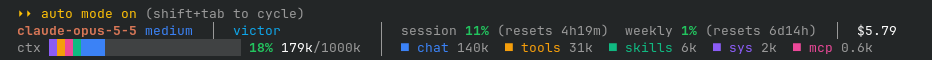

# usage-band

A Claude Code mod that shows your model, folder, usage limits, cost and context window right under the prompt.



## Install

```
/plugin install usage-band --marketplace VictorJermiin/claude-usage-band
```

## License

MIT
